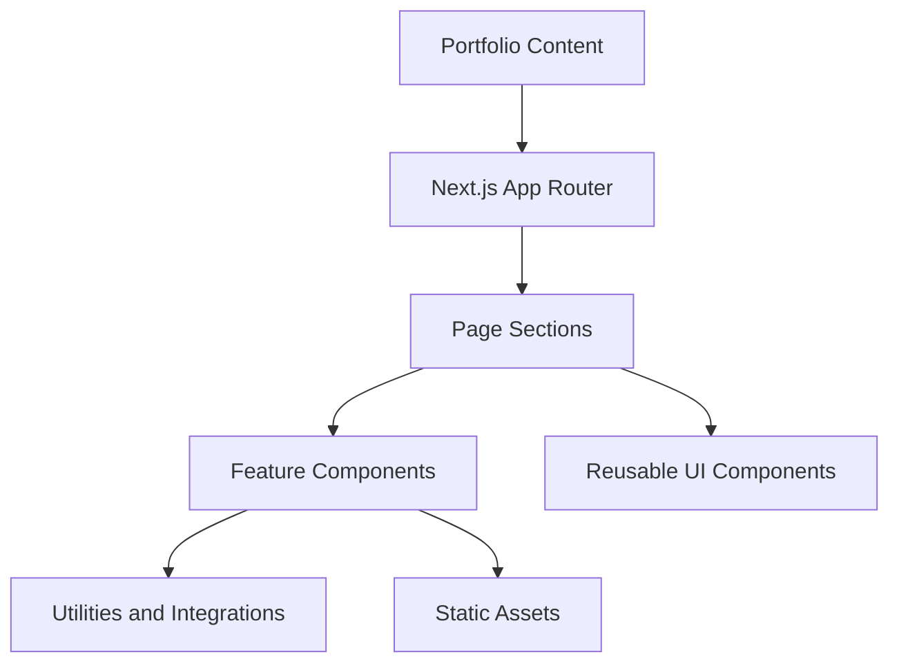

 <div align="center">

  

  # akhilesh.dev

  **Personal Developer Portfolio**

  <p><em>A portfolio built with Next.js, React, TypeScript, and Tailwind CSS to showcase my projects, technical work, and interests in backend engineering and Applied AI.</em></p>

  <p>
    
    
    
    
  </p>

  <p>
    <a href="https://www.linkedin.com/in/akhilesh-singh-dev"><strong>LinkedIn</strong></a> ·
    <a href="https://x.com/singh_akhil2272"><strong>X</strong></a>
  </p>

</div>

---

## What This Does

`akhilesh.dev` is my personal portfolio for presenting the projects I build and the engineering problems I'm learning to solve.

Rather than treating projects as a collection of cards with technology names, the portfolio provides a place to explore my work, understand the technologies behind it, and find links to the projects themselves.

The homepage brings together:

- A profile and introduction
- My technology stack
- Selected projects
- GitHub contribution activity
- Contact and social links

The content is maintained separately from the UI, allowing project information and profile details to be updated without rebuilding the page structure from scratch.

---

## Core Experience

The main experience is organized around exploring my work.

```text
Open Portfolio
      |
      v
View Profile
      |
      v
Explore About Section
      |
      v
Browse Technology Stack
      |
      v
Explore Projects
      |
      v
View GitHub Activity
      |
      v
Connect or View Resume
```

The goal is to make it easy to understand what I build, what I work with, and where to find more details.

---

## Architecture

The portfolio uses a component-based architecture built around Next.js and React.

The main page composes individual sections, while reusable layout components and UI primitives handle shared presentation.



The important boundaries are:

- **Content:** Profile, about text, stack configuration, and project definitions.
- **Sections:** The main sections rendered on the homepage.
- **Features:** Interactive components and project-specific presentation.
- **UI:** Reusable components shared across sections.
- **Utilities:** GitHub data retrieval, technology metadata, class-name helpers, and other supporting functions.
- **Assets:** Project images, profile image, video banners, and resume.

This separation keeps content definitions independent from their visual presentation.

---

## Homepage Composition

The homepage is assembled in `app/page.tsx`.

Its sections are rendered in the following order:

```text
Page
 |
 +-- Hero
 |
 +-- About
 |
 +-- Stack
 |
 +-- Projects
 |
 +-- GitHub Activity
 |
 +-- Connect
 |
 +-- Quote
```

Each section is implemented as a separate component under `components/sections/`.

This makes it easier to modify or reorder sections without putting the entire page into one large component.

---

## Content Architecture

Portfolio content lives in the `content/` directory.

### Site configuration

`content/site.ts` defines the main profile information, navigation, contact details, social links, resume path, and banner assets.

It also contains the configuration for the displayed local time zone.

### About section

`content/about.ts` contains the text used to introduce my work and technical interests.

### Technology stack

`content/stack.ts` defines the technologies displayed in the stack section.

The technology keys are mapped through the shared technology utilities rather than requiring each item to define its own presentation.

### Project definitions

Individual project entries live under `content/projects/`.

The project list is assembled in `content/projects/index.ts`:

```text
content/projects/
 |
 +-- beacon.ts
 +-- guardrail.ts
 +-- flowspace.ts
 +-- quizmon.ts
 +-- nexus.ts
 +-- luminary.ts
 +-- caseStudies.ts
 +-- index.ts
```

The project list is typed using the shared `Project` type.

This provides a single place to register projects while keeping their content in separate files.

---

## Interactive Features

### Theme switching

The portfolio supports light and dark themes through `next-themes`.

The theme provider is implemented in `components/layout/themeProvider.tsx`, while the toggle is implemented in `components/features/themeToggle.tsx`.

The theme is applied through the site's styling system.

Separate dark and light video banners are configured in `content/site.ts`.

### Command palette

The command palette provides an alternative way to navigate the portfolio.

Its UI is implemented through the command-menu components, keeping navigation interactions separate from the main page sections.

### GitHub activity

The GitHub activity section displays contribution activity using the project's GitHub utility.

The supporting code lives in `lib/github.ts` and the GitHub activity section component.

### Local time

The local-time component uses the configured `Asia/Kolkata` time zone to display local time.

### Project presentation

Projects can include images, technology tags, architecture details, and performance information through reusable feature components.

The relevant components include:

- `projectCard.tsx`
- `projectImage.tsx`
- `projectArchitecture.tsx`
- `projectPerformance.tsx`
- `techTag.tsx`

These components keep project presentation consistent without requiring every project to implement its own UI.

---

## Project Structure

```text
akhilesh.dev/
├── app/
│   ├── globals.css
│   ├── layout.tsx
│   ├── page.tsx
│   ├── icon.png
│   └── favicon.ico
│
├── components/
│   ├── features/
│   │   ├── commandPalette.tsx
│   │   ├── contributionGraph.tsx
│   │   ├── profileHeader.tsx
│   │   ├── projectArchitecture.tsx
│   │   ├── projectCard.tsx
│   │   ├── projectImage.tsx
│   │   ├── projectPerformance.tsx
│   │   ├── themeToggle.tsx
│   │   └── ...
│   │
│   ├── layout/
│   │   ├── header.tsx
│   │   ├── footer.tsx
│   │   ├── shell.tsx
│   │   ├── section.tsx
│   │   └── ...
│   │
│   ├── sections/
│   │   ├── hero.tsx
│   │   ├── about.tsx
│   │   ├── stack.tsx
│   │   ├── projects.tsx
│   │   ├── githubActivity.tsx
│   │   ├── connect.tsx
│   │   └── ...
│   │
│   └── ui/
│       ├── avatar.tsx
│       ├── button.tsx
│       ├── card.tsx
│       ├── tag.tsx
│       └── ...
│
├── content/
│   ├── projects/
│   ├── about.ts
│   ├── projects/
│   ├── quote.ts
│   ├── site.ts
│   └── stack.ts
│
├── lib/
│   ├── github.ts
│   ├── tech.ts
│   ├── cn.ts
│   └── sound.ts
│
├── public/
│   ├── projects/
│   ├── avatar.png
│   ├── banner-dark.mp4
│   ├── banner-light.mp4
│   ├── logo.png
│   └── resume.pdf
│
├── types/
│   └── content.ts
│
├── package.json
├── next.config.ts
├── tsconfig.json
└── README.md
```

---

## Component Architecture

The codebase separates page composition from individual features.

### Sections

Components under `components/sections/` represent the main areas of the portfolio.

They compose the content and reusable UI needed for each section.

### Features

Components under `components/features/` implement functionality that is more specific to the portfolio, such as project visualization, contribution activity, theme controls, and local time.

### Layout

Components under `components/layout/` provide the shared page structure, including the header, footer, shell, and section layout primitives.

### UI primitives

Components under `components/ui/` provide reusable interface elements.

This separation allows common UI behavior and styling to be maintained in one place.

---

## Technology Decisions

### Next.js

Next.js provides the application framework, routing, page composition, and production build pipeline.

The App Router is used to define the application's root layout and homepage.

### React and TypeScript

React provides the component model used throughout the portfolio.

TypeScript adds types to project content, component props, and shared utilities. The project definitions use a common `Project` type so the project list remains consistent.

### Tailwind CSS

Tailwind CSS is used for styling components and implementing the layout.

Shared UI primitives and layout components help keep spacing, borders, typography, and other visual decisions consistent.

### next-themes

`next-themes` manages theme switching between light and dark modes.

### GitHub integration

The GitHub utility and activity components support displaying contribution activity as part of the portfolio.

---

## Environment and Configuration

Most portfolio configuration is stored in `content/site.ts`.

This includes:

- Name and role
- Headline
- Location and time zone
- Email and social links
- Resume path
- Banner asset paths
- Navigation items

The project does not currently document a required `.env` file in its configuration.

If a future integration requires API credentials, those should be configured through environment variables and kept out of version control.

---

## Local Development

### Prerequisites

- Node.js compatible with Next.js 16
- npm

### Install dependencies

Clone the repository:

```bash
git clone https://github.com/Akhilesh-Singh-0/akhilesh.dev.git
cd akhilesh.dev
npm install
```

### Start the development server

```bash
npm run dev
```

Open [http://localhost:3000](http://localhost:3000) in your browser.

### Available scripts

| Command | Description |
| --- | --- |
| `npm run dev` | Starts the development server |
| `npm run build` | Creates a production build |
| `npm run start` | Starts the production server |
| `npm run lint` | Runs ESLint |

### Build for production

```bash
npm run build
npm run start
```

The production server starts after the build completes successfully.

---

## Updating Portfolio Content

The content-first structure makes common updates straightforward.

| What to change | Where to change it |
| --- | --- |
| Profile and social links | `content/site.ts` |
| About text | `content/about.ts` |
| Technology stack | `content/stack.ts` |
| Project details | `content/projects/` |
| Project ordering | `content/projects/index.ts` |
| Theme styling | `app/globals.css` |
| Homepage composition | `app/page.tsx` |
| Shared page layout | `components/layout/` |

For a new project, add its content definition, register it in the project index, and provide the relevant assets where needed.

---

## Current Capabilities

### Portfolio

- [x] Profile and introduction
- [x] About section
- [x] Technology stack
- [x] Project showcase
- [x] GitHub activity section
- [x] Contact and social links
- [x] Resume link

### UI and interaction

- [x] Light and dark themes
- [x] Command palette
- [x] Local-time display
- [x] Reusable UI components
- [x] Shared layout components
- [x] Project image and detail components

### Content management

- [x] Separate site configuration
- [x] Typed project definitions
- [x] Central project registry
- [x] Shared technology metadata

---

## Known Limitations

The portfolio will continue to evolve as the projects and content change.

Areas that may need future refinement include:

- Expanding project write-ups with more detailed engineering decisions.
- Adding further context to project architecture and performance details.
- Improving how project content and screenshots are maintained as the portfolio grows.
- Continuing to refine accessibility, responsive behavior, and interaction details.

---

## Deployment

The application can be deployed to a hosting platform that supports Next.js, including Vercel.

Before deploying, run a production build:

```bash
npm run build
```

Configure the deployment with the repository's Next.js setup and ensure that any external integrations required by the site are available.

---

## Contact

- **LinkedIn:** [Akhilesh Singh](https://www.linkedin.com/in/akhilesh-singh-dev)
- **X:** [@singh_akhil2272](https://x.com/singh_akhil2272)
- **Email:** [singhakhilesh19468@gmail.com](mailto:singhakhilesh19468@gmail.com)

---

<div align="center">
  <sub>Built by Akhilesh Singh.</sub>
</div>
